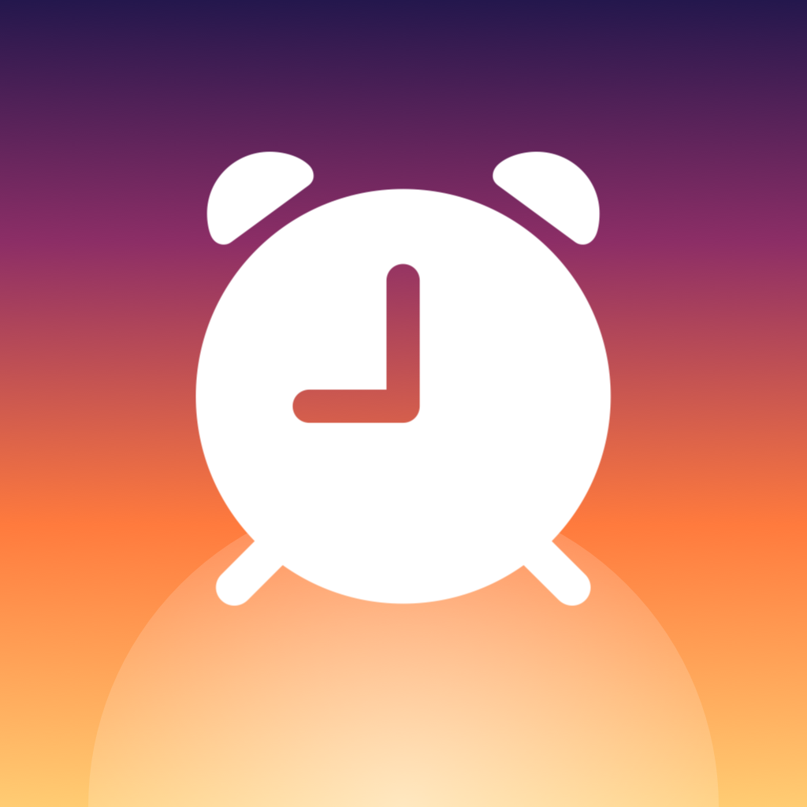
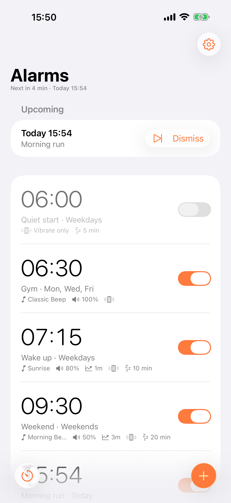
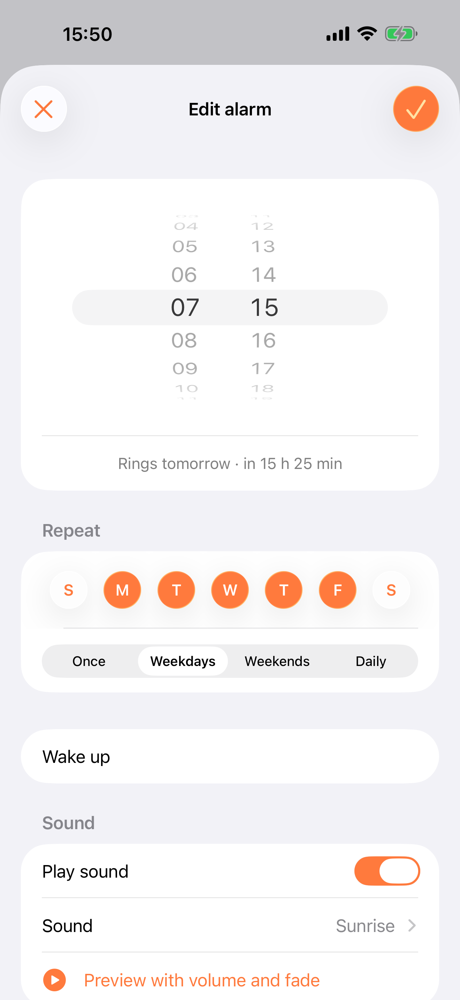
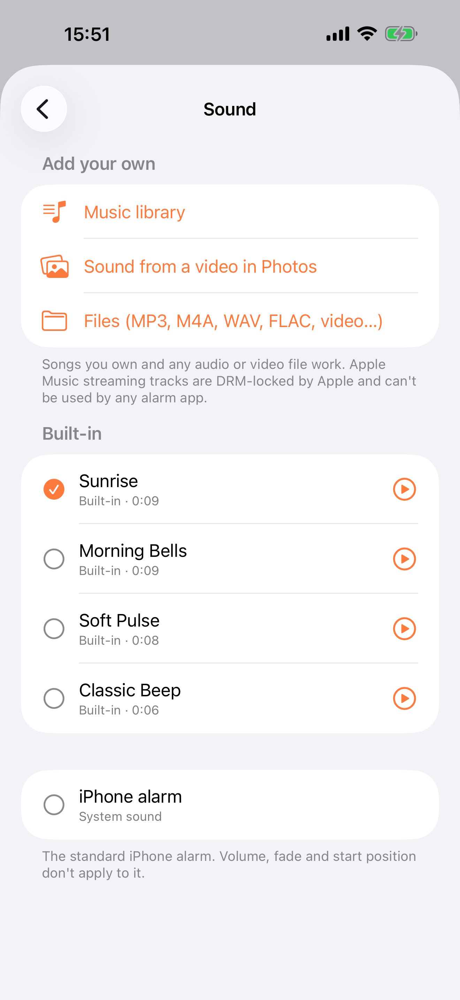
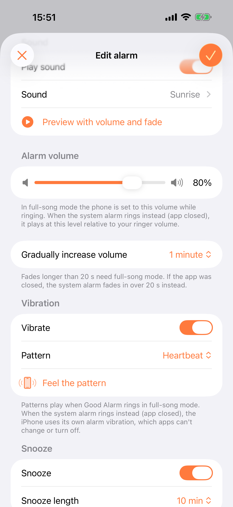
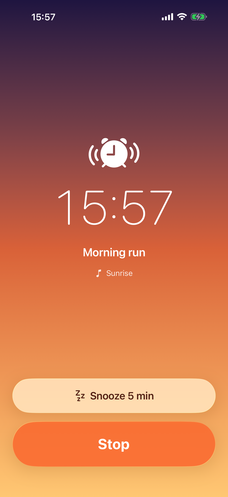
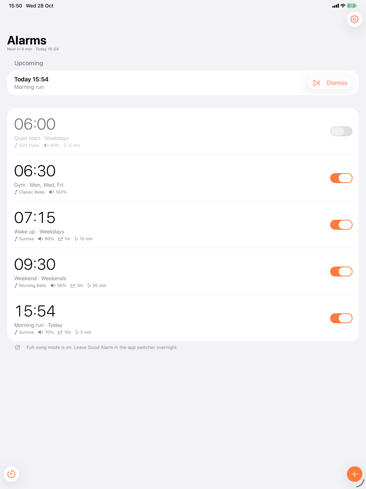
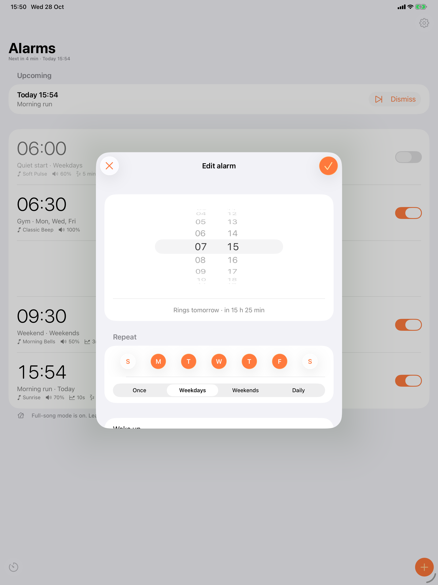
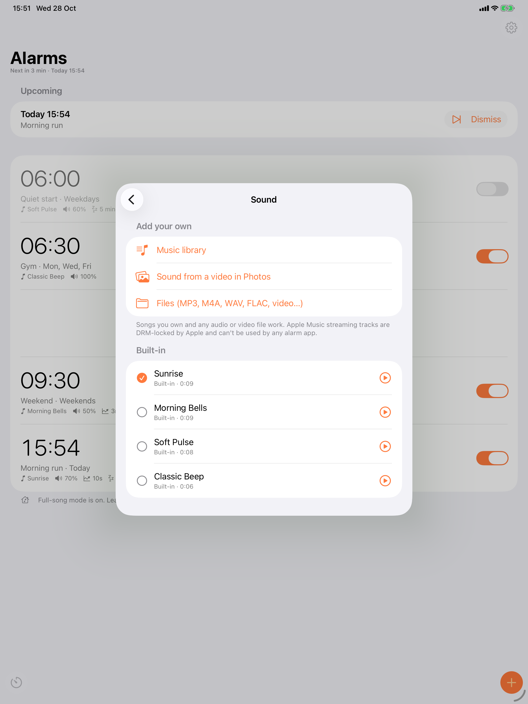
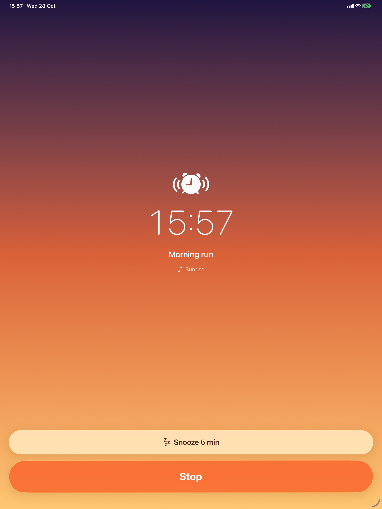

<p align="center">
  
</p>

# Good Alarm

An iOS alarm clock with the features Android has had for years: any song as the alarm,
volume per alarm, gradual fade-in, custom snooze length, skip next ring, and quick naps.

iPhone and iPad, iOS/iPadOS 26.1+ (AlarmKit). Built with Xcode 27, Swift 6 and SwiftUI, using native Liquid Glass components.

## Screenshots

<p align="center">
  
  
  
</p>
<p align="center">
  
  
  
</p>

<details>
<summary>iPad</summary>
<p align="center">
  
  
</p>
<p align="center">
  
  
</p>
</details>

## Build

```sh
brew install xcodegen   # once
xcodegen generate
open GoodAlarm.xcodeproj
```

Set your team under *Signing & Capabilities* for both targets (`GoodAlarm` and
`GoodAlarmWidgets`) and change the `io.github.joaomelorodrigues.*` bundle IDs in `project.yml` to your own.
Test real ringing on a device; the simulator doesn't reproduce silent mode or the lock screen.

## How it rings

| Layer | When | What you get |
| --- | --- | --- |
| **System alarm** (AlarmKit) | Always | Rings through silent mode, Focus and a closed app. Your song, start position, volume and fade (up to 20 s) are mixed into a 29 s clip in `Library/Sounds`, because AlarmKit has no volume API and needs sounds under 30 s. |
| **Full-song mode** (`RingEngine`, opt-in in Settings) | App left in the app switcher | Plays the whole track, sets the phone volume, fades in over up to 5 min. Seconds before the alarm it takes that ring over from AlarmKit and schedules a system **safety alarm** a few minutes later in case you sleep through it or the app dies. |

If the app is killed overnight, nothing was taken over, so the system alarm rings as usual.

## Features

- Sounds from the Music library (songs you own), the soundtrack of any video in Photos, or any
  audio/video file in Files. Four synthesized built-in tones; the iPhone default is also available.
- Start position inside the song, volume per alarm, "gradually increase volume" from 5 s to 5 min.
- Snooze on/off and 1–30 min length (iOS: fixed 9 min).
- Vibration on/off with patterns (Standard, Heartbeat, Rapid, Escalating) in full-song mode, and
  **vibrate-only** alarms: the system alarm plays a silent clip, so only the device's alarm vibration
  remains, and it works with the app closed. Hidden on devices without a vibration motor (iPad), where a
  vibrate-only alarm would be silent.
- Skip next ring of a repeating alarm, "dismiss early" for a one-time alarm.
- One-time alarms switch off after ringing, or delete themselves.
- Quick alarms: +10 / +20 / +30 / +60 min.
- "Alarm set for 7 h 32 min from now" confirmations.
- "Test system alarm in 10 seconds" to hear exactly what will wake you.
- Snooze countdown Live Activity on the Lock Screen and Dynamic Island.

## Code map

- `GoodAlarm/Scheduling/AlarmScheduler.swift`: syncs alarms into AlarmKit (skips, safety alarms, tests).
- `GoodAlarm/Audio/ClipRenderer.swift`: mixes volume and fade into the 29 s system clip.
- `GoodAlarm/Audio/RingEngine.swift`: full-song mode (keep-alive, takeover, lock screen controls).
- `GoodAlarm/Audio/SoundImporter.swift`: Music, Photos and Files import.
- `GoodAlarm/Store/AlarmStore.swift`: alarm list, persistence, lifecycle.
- `GoodAlarmWidgets/`: Live Activity required by AlarmKit for snooze countdowns.

## Known limits (Apple's, not ours)

- Apple Music streaming tracks are DRM-protected; no app can use them as audio files.
- AlarmKit has no vibration API: the system alarm always vibrates the device's own way and apps can't
  turn that off. Patterns apply only when the app rings in full-song mode.
- With the app closed, the alarm plays at ringer volume (your volume setting scales it down).
- Setting the phone volume uses the `MPVolumeView` slider workaround that most alarm apps use.
- Keeping the app alive with silent background audio is how Alarmy and others do it. App Review
  has accepted it for alarm apps, but it isn't guaranteed.
- Some iOS 26 betas ignored custom sounds in `Library/Sounds`. Use the in-app test button on your
  device's iOS version.
